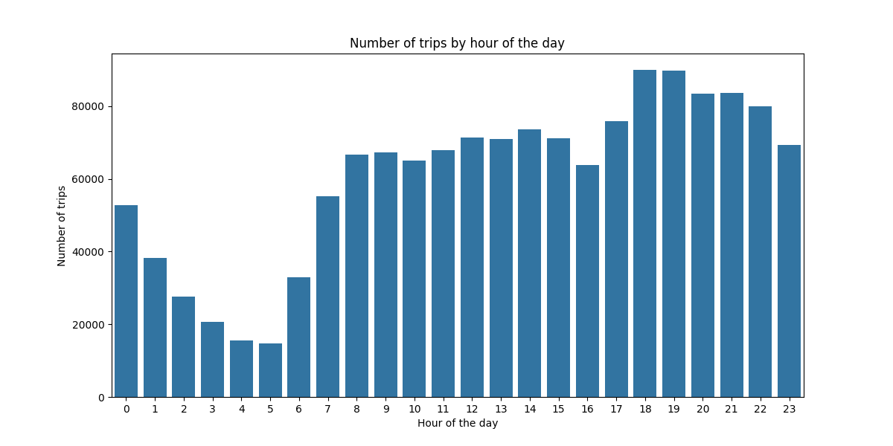
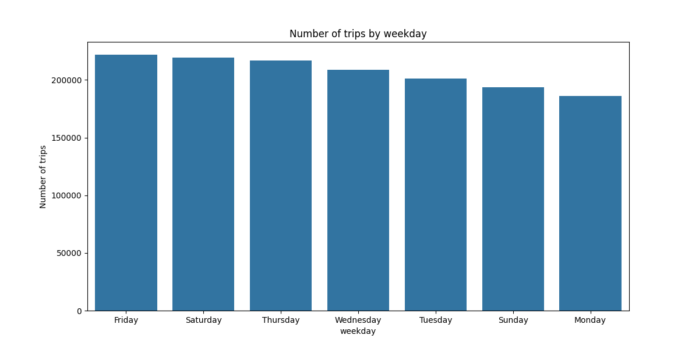
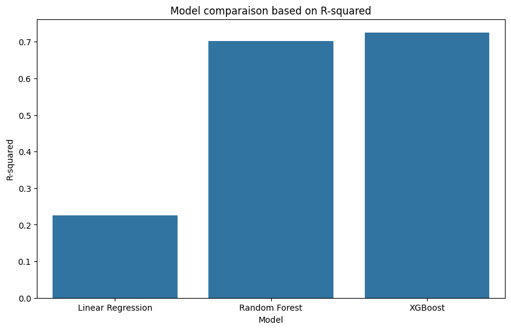
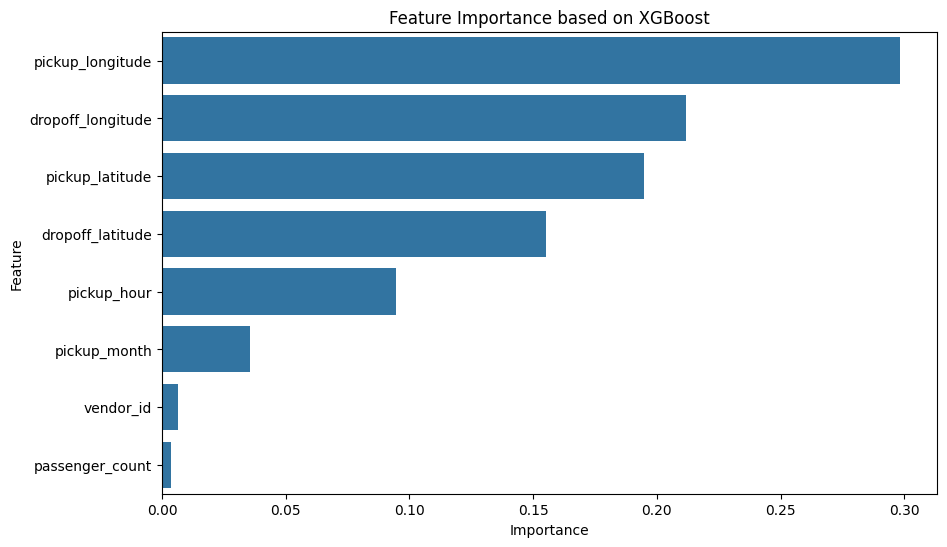
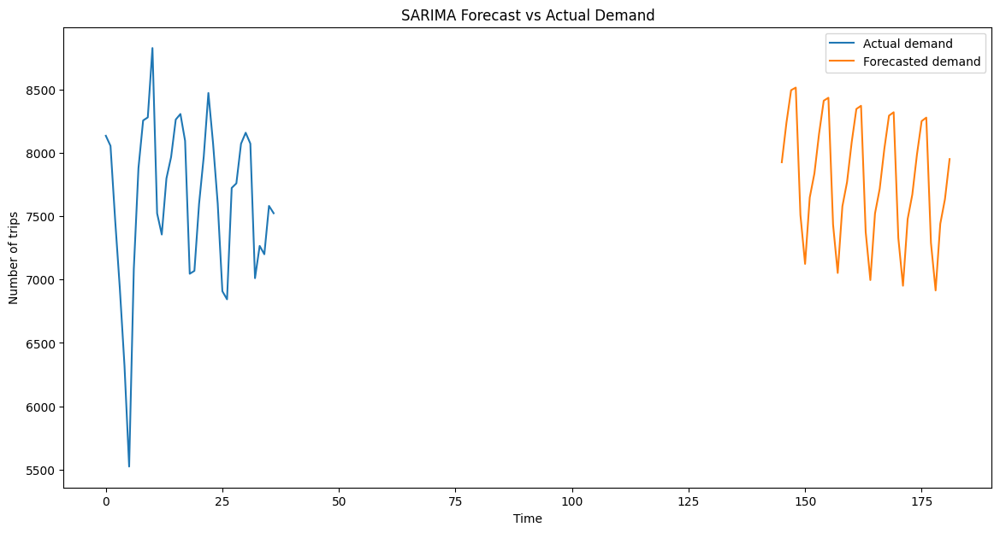

#  Smart City Analytics

## Project Overview

Smart City Analytics is an end-to-end Data Science project developed using the NYC Taxi Trips dataset.

The project explores urban mobility patterns, predicts taxi trip duration, forecasts future transportation demand, and compares traditional data processing techniques with Big Data technologies.

This project demonstrates the complete Data Science workflow, from data preparation and exploratory analysis to machine learning, time series forecasting, and Big Data processing.

---

#  Business Problem

Urban transportation systems generate large volumes of operational data every day.

Transportation authorities and mobility service providers need data-driven solutions to:

- Understand travel patterns
- Predict trip duration
- Forecast future demand
- Improve operational planning
- Optimize resource allocation

The goal of this project is to transform raw taxi trip data into actionable business insights and predictive models.

---

#  Dataset

## NYC Taxi Trips Dataset

The dataset contains more than **1.4 million taxi trips** recorded in New York City.

### Main Variables

| Feature | Description |
|----------|------------|
| vendor_id | Taxi vendor identifier |
| pickup_datetime | Trip start timestamp |
| dropoff_datetime | Trip end timestamp |
| passenger_count | Number of passengers |
| pickup_longitude | Pickup longitude |
| pickup_latitude | Pickup latitude |
| dropoff_longitude | Dropoff longitude |
| dropoff_latitude | Dropoff latitude |
| trip_duration | Trip duration in seconds |

### Dataset Size

- Records: **1,458,644+**
- Features: **11**

---

#  Project Workflow

```text
Data Preparation
        ↓
Exploratory Data Analysis
        ↓
Machine Learning
        ↓
Time Series Forecasting
        ↓
Big Data Processing
```

---

#  Phase 1 - Data Preparation

## Activities Performed

- Data quality assessment
- Missing values analysis
- Duplicate detection
- Datetime conversion
- Feature engineering
- Outlier detection
- GPS coordinates validation
- Data cleaning

## Results

 No missing values detected

 No duplicate records detected

 Outliers treated successfully

 Clean dataset exported for analysis

---

#  Phase 2 - Exploratory Data Analysis

## Analyses Performed

- Trip demand by hour
- Trip demand by weekday
- Passenger count distribution
- Trip duration analysis
- Correlation analysis
- Mobility pattern exploration

## Key Insights

- Peak demand occurs between **6 PM and 9 PM**
- Friday records the highest taxi demand
- Most trips involve one passenger
- Geographic location strongly impacts trip duration

---

#  Phase 3 - Machine Learning

## Objective

Predict trip duration using trip characteristics and location information.

### Features

- vendor_id
- passenger_count
- pickup_longitude
- pickup_latitude
- dropoff_longitude
- dropoff_latitude
- pickup_hour
- pickup_month

### Target Variable

```text
trip_duration
```

---

## Models Evaluated

### Linear Regression

| Metric | Value |
|----------|----------|
| MAE | 414.57 |
| RMSE | 573.71 |
| R² | 0.23 |

### Random Forest Regressor

| Metric | Value |
|----------|----------|
| MAE | 249.35 |
| RMSE | 355.63 |
| R² | 0.70 |

### XGBoost Regressor

| Metric | Value |
|----------|----------|
| MAE | 232.29 |
| RMSE | 341.45 |
| R² | 0.73 |

---

## Best Model

 **XGBoost Regressor**

Performance:

```text
R² = 0.73
```

The model successfully explained approximately 73% of the variance in trip duration.

---

## Feature Importance

The most influential variables were:

1. pickup_longitude
2. dropoff_longitude
3. pickup_latitude
4. dropoff_latitude
5. pickup_hour

Location-related variables were the strongest predictors of travel time.

---

#  Phase 4 - Time Series Forecasting

## Objective

Forecast future taxi demand using historical trip data.

---

## Time Series Analysis

### Performed Analyses

- Daily demand aggregation
- Moving Average (7 days)
- Stationarity testing (ADF)
- ACF analysis
- PACF analysis

### ADF Test

```text
ADF Statistic = -3.516
p-value = 0.0076
```

### Result

 Stationary Time Series

---

## Forecasting Model

### SARIMA

```text
SARIMA(1,0,1)(1,0,1,7)
```

Weekly seasonality was detected and incorporated into the model.

---

## Forecasting Performance

| Metric | Value |
|----------|----------|
| MAE | 352.47 |
| RMSE | 523.13 |

---

## 7-Day Demand Forecast

| Day | Predicted Trips |
|-----|----------------|
| Day 1 | 7,927 |
| Day 2 | 8,238 |
| Day 3 | 8,496 |
| Day 4 | 8,516 |
| Day 5 | 7,510 |
| Day 6 | 7,124 |
| Day 7 | 7,649 |

---

#  Phase 5 - Big Data Processing with PySpark

## Objective

Compare Pandas and PySpark performance on the NYC Taxi dataset.

---

## Performance Comparison

| Operation | Pandas (sec) | PySpark (sec) |
|------------|------------:|------------:|
| Load Dataset | 7.73 | 4.65 |
| GroupBy Vendor | 0.09 | 2.67 |

---

## Findings

### Data Loading

PySpark loaded the dataset faster than Pandas.

### Aggregation

Pandas outperformed PySpark for simple aggregation tasks.

### Interpretation

The dataset remains manageable on a single machine.

However, PySpark offers better scalability for large-scale enterprise environments containing hundreds of millions of records.

---
# Project Visualizations

## Number of Trips by Hour



---

## Weekday Demand



---

## Model Comparison



---

## Feature Importance



---

## SARIMA Forecast




#  Technologies Used

- Python
- Pandas
- NumPy
- Matplotlib
- Seaborn
- PostgreSQL
- Scikit-Learn
- XGBoost
- Statsmodels
- PySpark
- Jupyter Notebook
- Git
- GitHub

---

#  Repository Structure

```text
smart-city-analytics/

├── data/
│   ├── raw/
│   └── processed/
│
├── notebooks/
│   ├── 01_data_preparation.ipynb
│   ├── 02_exploratory_data_analysis.ipynb
│   ├── 03_machine_learning.ipynb
│   ├── 04_time_series_forecasting.ipynb
│   └── 05_big_data_pyspark.ipynb
│
├── database/
│   └── database.sql
│
├── models/
│
├── reports/
│
├── requirements.txt
├── README.md
└── .gitignore
```

---

# Skills Demonstrated

- Data Cleaning
- Exploratory Data Analysis (EDA)
- Feature Engineering
- Machine Learning
- XGBoost
- Time Series Forecasting
- SARIMA
- PostgreSQL
- Big Data Processing
- PySpark
- Data Storytelling
- Git & GitHub

---

# Author

**Aliou Diallo**

Data Science and Artificial Intelligence Graduate

---

#  Future Improvements

- Streamlit Dashboard
- Real-Time Data Pipeline
- Docker Deployment
- Cloud Integration (Azure/AWS)
- Advanced Geospatial Analysis
- Model Deployment API

---